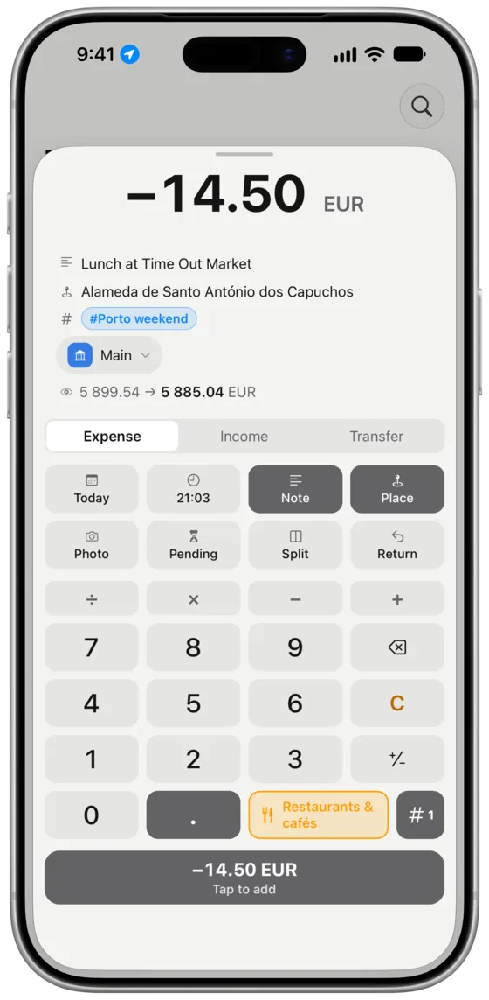
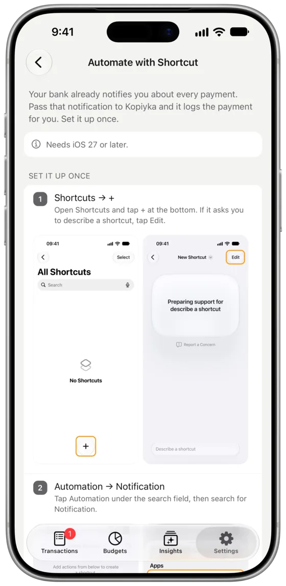
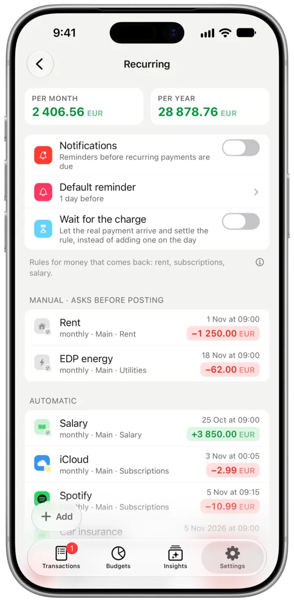
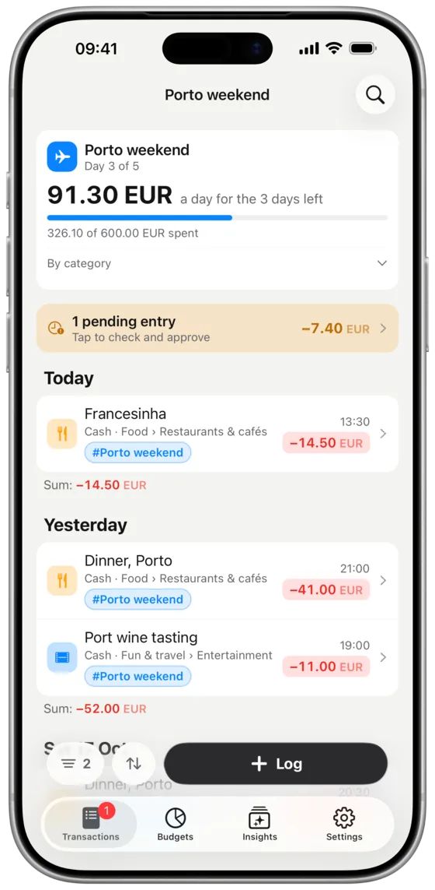
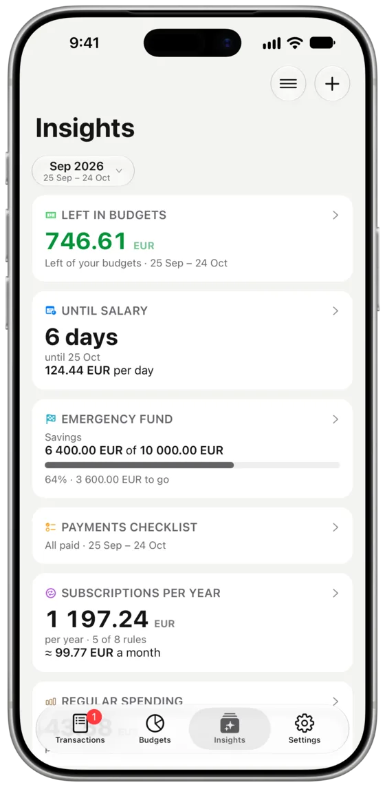

# Kopiyka Budget

**A fast, local-first budget tracker for iPhone, iPad and Apple Watch.** Log an expense in two taps,
keep every number on your own device, and get budgets that start on payday instead of the 1st.
Free, open source, no account, no server, no trackers.

**[Download on the App Store](https://apps.apple.com/us/app/kopiyka-budget/id6809896169)** ·
[Website](https://sashago3.github.io/kopiyka-budget/)

[](LICENSE)


<p align="center">
  
  
  
  
  
</p>

## Why

I have logged every expense for more than ten years. The last app I paid for had become slow, its
bugs went unfixed and its Apple Watch app stopped working. I have built React Native apps for a
living for years, so I made the one I wanted: free, local, quick, and pleasant to use. Your data is
yours, and you can take it anywhere in a minute.

## What it does

- **Logging:** a calculator keypad with the category on the key beside it, also on Apple Watch, Siri
  and Shortcuts. On iOS 27 a Shortcuts automation turns your bank's payment notification into a
  pending entry, read on the device (beta).
- **Money:** several accounts and currencies, transfers, budgets for a month that starts on payday,
  recurring payments, trips and events with their own budget, debts, and insights you pick.
- **Your data:** one SQLite file on the phone, a daily backup in your own iCloud Drive, and export as
  JSON, CSV or a ZIP with receipt photos. Moving from another app? See
  [migrating with AI](docs/migrate-with-ai.md).

## Building

You need a Mac with Xcode 27, [Bun](https://bun.sh), Node 20+ and CocoaPods.

```sh
bun install
bun test                     # core and translations

cd apps/mobile
bun run prebuild             # generates ios/ with the watch targets
bun run ios                  # dev build on a simulator
```

A real device or TestFlight needs your Apple Developer Team ID in `apps/mobile/.env` (copy
`.env.example`). Screenshots, the store listing and the website have their own guides:
[screenshots](apps/mobile/screenshots/README.md), [site](site/README.md).

```
packages/core     TypeScript, no platform code: schema, backups, budgets, recurring, trips, insights
packages/i18n     English and Ukrainian, compiled for the app, Swift, the website and the store
apps/mobile       the Expo app; native/ is its Swift, targets/ the Apple Watch app and complication
site/             the website
```

Read [DATA.md](DATA.md) before writing anything that imports, merges or deletes rows.
[docs/how-it-works.md](docs/how-it-works.md) covers backups, the watch and the automation.

## Privacy

Kopiyka collects nothing. Its only network request is for exchange rates (`api.frankfurter.dev`:
two currency codes and a date). See the [privacy policy](docs/privacy-policy.md) and
[terms of use](docs/terms-of-use.md).

## Contributing

Issues and pull requests are welcome: [CONTRIBUTING.md](CONTRIBUTING.md). Security reports:
[SECURITY.md](SECURITY.md). Android is not planned, but the core package is platform-agnostic if you
want to try.

Built on [Expo](https://expo.dev), [React Native](https://reactnative.dev),
[@bacons/apple-targets](https://github.com/EvanBacon/expo-apple-targets), [Bun](https://bun.sh),
[fflate](https://github.com/101arrowz/fflate), [Papa Parse](https://www.papaparse.com) and
[Frankfurter](https://frankfurter.dev). Payment logos come from [Simple Icons](https://simpleicons.org)
(CC0) and [Arcticons](https://github.com/Arcticons-Team/Arcticons) (CC BY-SA 4.0, see
`apps/mobile/assets/icons/logos/LICENSE.md`); every mark is its owner's trademark.

## License

[MIT](LICENSE).
