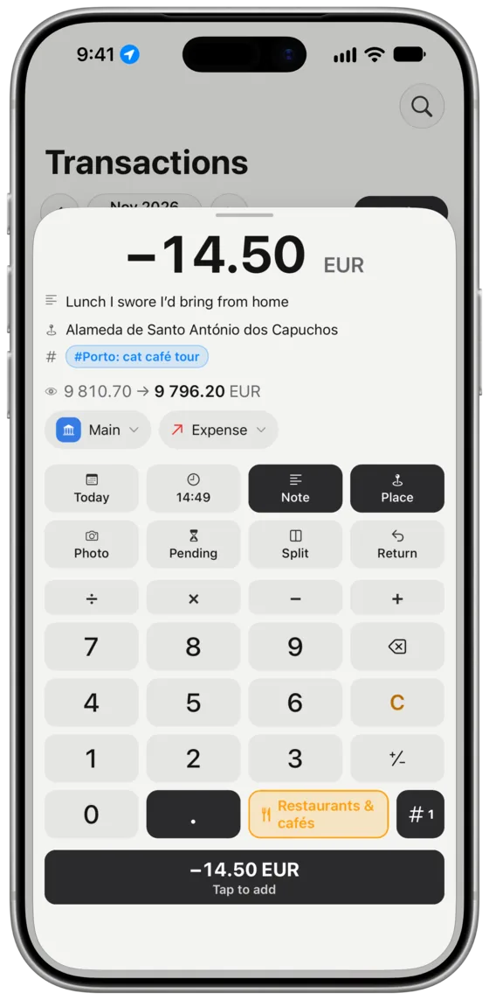
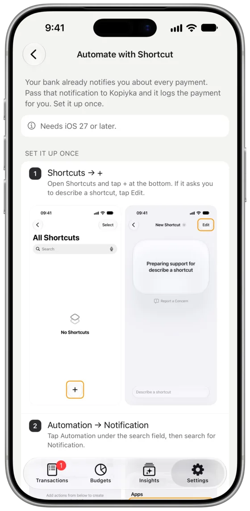
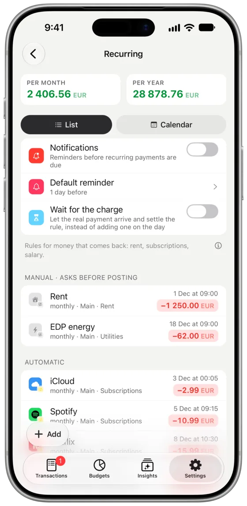
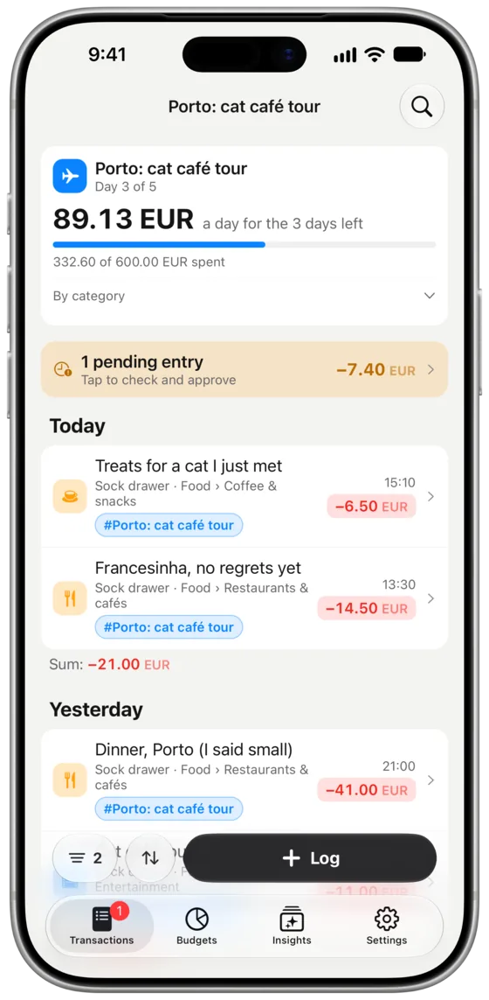
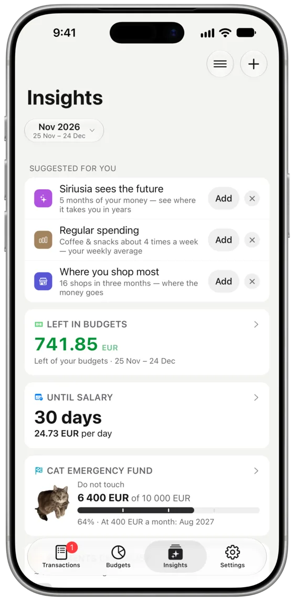

# Kopiyka Budget

**A fast, local-first budget tracker for iPhone, iPad and Apple Watch.** Log an expense in two taps,
keep every number on your own device, and get budgets that start on payday instead of the 1st.
Free, open source, no account, no server, no trackers.

**[Download on the App Store](https://apps.apple.com/us/app/kopiyka-budget/id6809896169)** ·
[Website](https://sashago3.github.io/kopiyka-budget/)

[](LICENSE)


<p align="center">
  
  
  
  
  
</p>

## Why this exists

Not knowing where I stood with money used to drive me mad, so more than ten years ago I started
logging every expense. The first app I used was free when I began and later became a one-time
purchase, which was fair enough. The habit stuck, but the app never gave me any real insight into
where my money was actually going.

For the last two years I used a budgeting app that cost quite a lot as a one-time purchase. The
developer had gone quiet on known bugs, and the “native” iOS app had become painfully slow: I would
wait a couple of seconds before I could type a single digit. The last straw was the Apple Watch app,
which simply stopped working. The explanation was “Apple”, while everything else on the watch worked
fine. It was not Apple.

I have worked as a React Native developer for many years, shipping apps that real people use every
day, and I had wanted for a long time to give something back to open source and fix this one
problem: a free, local app for tracking money that is actually good and pleasant to use. I finally
had the reason.

I am happy with how it turned out. The Shortcuts automation alone removes almost all of the friction
I used to have, and tags paired with categories feel so obvious that I still wonder why nobody did
it. I built this with care and I intend to keep looking after it. Your data is yours, so if I ever
get hit by a bus you can take it anywhere in a minute. I am not planning on that: I have a daughter,
Olivia, on the way, and a lot to live for.

Thank you for trying Kopiyka.

## What it does

**Logging**
- Two taps: the entry sheet opens on a calculator keypad, with Category and Tags on the keys beside
  it. It does arithmetic, so `12.50 + 3` is fine. Note, date, place, photo and a pending flag are
  one tap away.
- It learns from you: a shop you have filed before files itself, and with location on, the category
  you used near here is suggested first. A "home" location turns the suggestion off where anything
  can be bought.
- Split one receipt into several entries (dinner and a lamp from the same shop), each with its own
  category and tags. Duplicate an entry, or select several and edit them at once.
- Receipt photos on any entry. Hold + for the receipt camera: it finds the paper, takes the picture
  itself and reads the shop, total, address and every line on the device, then can split the lines
  by category. A receipt in another currency asks which account paid.
- Shops it already knows: Biedronka, Lidl, Сільпо, АТБ, Orlen, Uber and a few hundred more are
  recognised the first time you pay there and filed into your category of that kind, whatever you
  called it. The payment still waits in Pending for your yes.
- Siri and Shortcuts actions: add an expense, open the keypad, scan a receipt.
- **Bank notifications (beta, iOS 27):** a Shortcuts automation hands your bank's payment
  notification to Kopiyka, which reads the amount, shop, card and time out of the text on the
  device, silently, with the app closed. The entry waits in Pending for you to approve, and what the
  bank said is kept apart from your own note. When the bank notifies both sides of a transfer
  between your own accounts, the two become one transfer. No bank connection, nothing leaves the
  phone.
- Search on its own screen, across notes, shops, tags, trips, events and debts, typos and all, plus
  filters on the transaction list.

**Apple Watch**
- The same keypad, categories and tags, today's entries and what is left in each budget.
- Approve pending payments, add a note by dictation, delete an entry.
- Log from a complication, the Smart Stack, Control Center or the Action button of an Ultra.

**Accounts and money**
- Several accounts in several currencies (cash, bank, card, savings, investment), in groups you
  name, with net worth in your base currency.
- Transfers between accounts, across currencies too, with both amounts typed so the bank's rate or
  fee is kept as it was. Exchange rates from the European Central Bank are kept day by day, so an
  old transfer still converts correctly.
- A payment charged in another currency keeps its original amount and rate, to check and correct.

**Categories and tags**
- Categories inside folders, each with its own icon and colour, and a ready-made set to start from.
- Tags beside categories, limited to the categories they make sense for.
- Archive a category or a tag instead of deleting it: history stays, it just stops being offered.
- Mark how much each category matters (a folder answers for what is inside it), and see the month
  split by it.

**Budgets**
- For a category, a folder, a tag, several of them, or everything, in a month that starts on
  payday: the 1st, the 15th, the 25th or any day you choose.
- Planned and Available: what is set aside and what is left. A budget can stay on screen as a
  yardstick without counting towards Planned.
- Tap a budget to see what is behind it, month by month.

**Recurring payments**
- Subscriptions post themselves on the day and tell you; bills whose amount moves around wait for a
  tap.
- Or wait for the bank: with the notification automation, the real charge claims the payment, at
  the bank's amount and on the bank's day, so a price rise files itself correctly.
- Kopiyka spots repeats in your history and offers to make rules; the ones you do not want can be
  dismissed for good.
- Each one shows the company's logo, or an icon, emoji or picture you choose.
- A calendar of them: paid, late and still to come. One payee with two bills (rent and the service
  charge) is told apart by the amount.

**Trips and events**
- Name a trip or an event (a birthday, a wedding, a night out), give it a budget and its days, and
  every expense is tagged and counted against it, with a daily allowance, in whatever currency you
  spend. Your monthly budgets stay as they were.
- Go without a limit and just count what was spent, record one that already happened, add earlier
  purchases to it, or keep a few (the flights booked months ago) outside its budget.
- Rename one whenever you like: everything already tagged with it follows.

**Friends**
- Split a bill with friends: an equal share, their own items or a typed amount. Their part is
  theirs, not your spending, and each friend has a page with what they owe, Remind and Let it go.

**Debts**
- Who owes whom, with a reminder on the due date.
- Pay one back in parts: pick Debt instead of a category, and the debt counts what has been paid
  and settles itself when it is covered.

**Insights you pick**
- Left in budgets, days until salary and what you can spend per day, a savings goal, one account's
  balance, a payments checklist, subscriptions per year, regular spending, what the month went on
  and a safety buffer in months. Tap one to see what is behind it.
- Siriusia sees the future: your own pace, every currency added into one, carried forward. When the
  savings goal lands, what a home would take, what a daily coffee costs over ten years. She is a
  cat, so it is a forecast, not a promise.
- This month against your usual, your biggest one-off purchases, where you shop most, and a
  spending map. Insights suggests cards from how you use the app.

**Your data**
- Everything is in a SQLite file on your phone. No account, no server, no analytics, no ads.
- A full backup goes to your own iCloud Drive (Files → iCloud Drive → Kopiyka) after changes and at
  least daily, with receipt photos beside it; you choose how long backups are kept. Restore from any
  of them, merging or replacing everything.
- Two of your own devices on the same iCloud account keep each other level through those backups.
- Export any time as JSON (everything), CSV (transactions) or a ZIP bundle with the photos in it.
- Moving from another app? Hand your old export and [this prompt](docs/migrate-with-ai.md) to an AI
  assistant and import the result.

**Everything else**
- iPhone, iPad and Apple Watch, and ready for iPhone Duo, folded or open.
- Undo instead of "Are you sure?", and categories ordered by how often you use them or dragged into
  place.
- Four colour themes, each named after a cat, each light and dark.
- In English and Ukrainian.
- Free and open source. Nothing to unlock, now or later.

## Building

You need a Mac with Xcode 27, [Bun](https://bun.sh), Node 20+ and CocoaPods.

```sh
bun install
bun test                     # core and translations

cd apps/mobile
bun run prebuild             # generates ios/ with the watch targets
bun run ios                  # dev build on a simulator
```

A real device or TestFlight needs your Apple Developer Team ID in `apps/mobile/.env` (copy
`.env.example`). Screenshots, the store listing and the website have their own guides:
[screenshots](apps/mobile/screenshots/README.md), [site](site/README.md).

```
packages/core     TypeScript, no platform code: schema, backups, budgets, recurring, trips, insights
packages/i18n     English and Ukrainian, compiled for the app, Swift, the website and the store
apps/mobile       the Expo app; native/ is its Swift, targets/ the Apple Watch app and complication
site/             the website
```

Read [DATA.md](DATA.md) before writing anything that imports, merges or deletes rows.
[docs/how-it-works.md](docs/how-it-works.md) covers backups, the watch and the automation.

## Privacy

Kopiyka collects nothing. Its only network request is for exchange rates (`api.frankfurter.dev`:
two currency codes and a date). See the [privacy policy](docs/privacy-policy.md) and
[terms of use](docs/terms-of-use.md).

## Contributing

Issues and pull requests are welcome: [CONTRIBUTING.md](CONTRIBUTING.md). Security reports:
[SECURITY.md](SECURITY.md). Android is not planned, but the core package is platform-agnostic if you
want to try.

Built on [Expo](https://expo.dev), [React Native](https://reactnative.dev),
[@bacons/apple-targets](https://github.com/EvanBacon/expo-apple-targets), [Bun](https://bun.sh),
[fflate](https://github.com/101arrowz/fflate), [Papa Parse](https://www.papaparse.com) and
[Frankfurter](https://frankfurter.dev). Payment logos come from [Simple Icons](https://simpleicons.org)
(CC0) and [Arcticons](https://github.com/Arcticons-Team/Arcticons) (CC BY-SA 4.0, see
`apps/mobile/assets/icons/logos/LICENSE.md`); every mark is its owner's trademark.

## License

[MIT](LICENSE).
